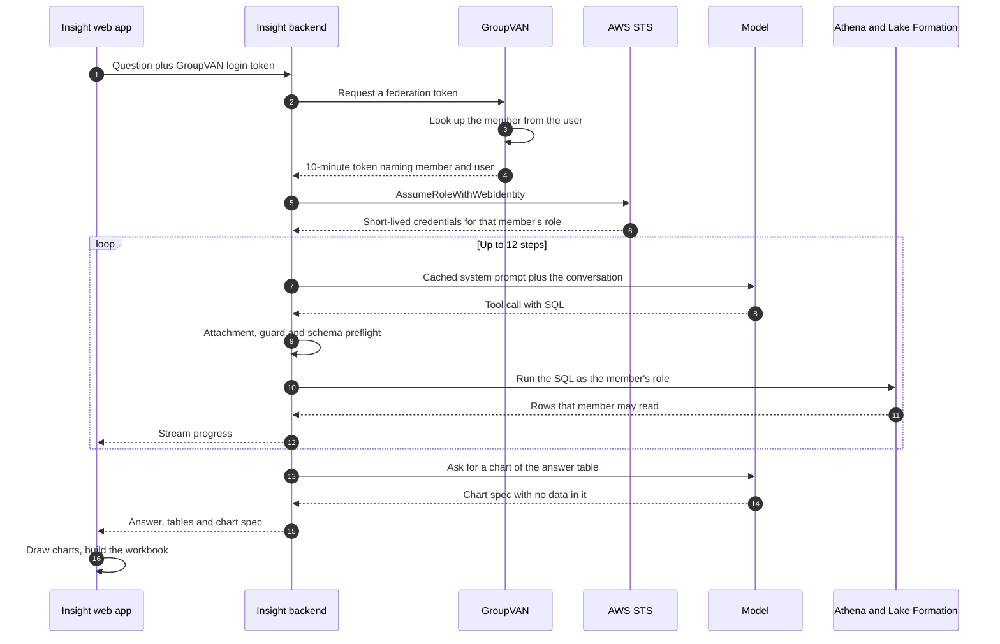

A buyer at a distributor with a handful of stores types "What should I stock that
I'm losing sales on?" or "Where is my pricing above or below market?" They get back
a short answer, the table behind it, a chart, and a spreadsheet to bring to the
purchasing meeting, all drawn from their own numbers.

That's **Insight**: our in-house data warehouse, with an AI analyst built on top. In
[the GroupVAN post](/posts/what-is-groupvan/) we called the gateway "dumb on purpose:
it relays and logs, and the analysis happens downstream." Insight is the downstream
part, and the step [the plain-English post](/posts/groupvan-in-plain-english/) said
we were piloting. It's running with a small group of pilot members and isn't
generally available yet.

Writing decent SQL turned out to be **the easy part** for the model. The hard part
was keeping each member inside its own data, even though a model is writing the SQL.
The next hardest was making the answers worth believing.

> The design rule: the model is an untrusted SQL generator. Whatever it writes runs
> as the member who asked, against rows that member may read, and nothing else.
{: .prompt-tip }

## What a question turns into

Insight is a Flutter web app, product number five on
[the bet we keep making](/posts/one-bet-four-products/). This time the backend is
Dart too, on [Dart Frog](https://dartfrog.vgv.dev/). It has exactly three runtime
dependencies: `dart_frog`, `http` and `crypto`. We don't use an AWS SDK or an LLM
SDK. We wrote the request signing, the STS exchange, and the Athena and chat clients
ourselves. It's more code to own, but the surface is small, and the code that signs
requests and exchanges tokens is ours to read.

Each question runs as an **agent loop**. The model is Claude Sonnet 5.5, reached
through an AI gateway, with Sonnet 5 as a fallback. It gets up to twelve steps and
three tools. The third, `deliver_list`, is live in development and comes to pilot
members in the next release:

- **`run_query`** — run one read-only SELECT and see a preview of the result.
- **`lookup_docs`** — fetch the written methodology for a metric, such as how lost
  sales are estimated, so the model doesn't have to guess.
- **`deliver_list`** — run the query whose full result *is* the answer: the buy
  list, the gap list, the list that fills a fixed budget.

The prompt tells the model to work like an analyst. It runs small queries first, to
check that a brand code resolves and a join returns rows. An empty result is a clue
to try something else, not the answer. If it runs out of steps, the backend makes
one last call with no tools, so the model has to answer with what it has. Each step
streams to the browser as it happens, so the buyer watches the analysis instead of a
spinner.

## Security lives below the model

Isolation must not depend on the model behaving, or on any code that inspects what
it wrote.



**The login token never reaches AWS.** A member signs in with their normal GroupVAN
login. GroupVAN also acts as an OpenID Connect issuer, and for each question the
backend uses that login to ask it for a separate **federation token**. That token is
signed, lasts ten minutes, and carries a dedicated audience that only our AWS roles
accept, so no other service will take it. Its subject names the member and the user:

```text
sub: member:<id>:user:<uid>
aud: <a dedicated audience only our AWS roles accept>
exp: issued_at + 10 minutes
```
{: .nolineno }

**The member never travels in the request.** The browser can ask for a *kind* of
data, but it never says which member it is. GroupVAN checks that the user has the
Insight entitlement, then looks up their member on its own side. Since the request
carries no member field, there's no member id for a client to tamper with.

**Trust policies do the choosing.** Each pilot member has its own IAM role. The
backend reads the member from the subject and asks AWS STS (the service that trades
a trusted token for short-lived credentials) for that role. That lookup is a
convenience. The control is the role's trust policy: for federation, it accepts only
tokens from our GroupVAN issuers, with our audience and that member's subject prefix:

```json
"Condition": {
  "StringEquals": { "<issuer>:aud": "<federation audience>" },
  "StringLike":   { "<issuer>:sub": "member:<id>:*" }
}
```
{: .nolineno }

A token minted for one member can't assume another member's role, no matter what the
backend asks for. Nothing is cached, either: every question mints a fresh token and
makes a fresh STS call.

**Lake Formation enforces the rows.** Lake Formation is AWS's permission layer for
warehouse tables. When the role queries through Athena, it can read a member-scoped
table only through a row filter, `member_id = '<id>'`. Shared reference data
(catalog, fitment, interchange, specs, vehicles in operation, network pricing) is
granted unfiltered, because it's the same for everyone. Queries run in a dedicated
Athena workgroup, which enforces its own settings and a hard per-query scan cap. The
role can't run queries anywhere else.

So GroupVAN decides the member, a trust policy decides the role, and Lake Formation
decides which rows a query returns. The model can write any SQL it likes. It just
can't write its way out of the role it runs in.

## Views can't be row-filtered, so we materialize

Lake Formation row filters attach to tables, not views. That limit shaped the
warehouse more than anything the model needed. We build member-scoped data (margins,
demand, stock guides, line history) as **materialized tables**, so each one can carry
a filter. We grant a network view only when every table under it holds network data.
That last rule came the slow way. Athena runs a view with the *caller's* permissions,
and a few handy views read raw member events that no member role can see. They didn't
leak anything. They just failed for every member, every time, and the agent kept
trying them. We took them out of the catalog.

One more trap: our early mart rebuild used DROP and CREATE, which quietly deleted the
Lake Formation tags our grants are written against, and Terraform couldn't see they
were gone. Access failed closed, which is the right way to fail. We're moving
governed marts to Iceberg, an open table format that supports row-level changes, and
refreshing them with DELETE plus INSERT, so a routine refresh keeps the table and its
tags. A schema change still recreates the table, and the rebuild re-tags it
afterwards.

## Teaching the model the warehouse

The model learns our schema the blunt way: the whole **catalog** goes in its system
prompt. That's about 70 KB of plain text:

- global rules
- one canonical source per business question
- sanity bounds
- recipes for the joins that bite
- an exact-columns appendix covering about 80 tables

The appendix comes with a strict rule: if a column isn't listed, it doesn't exist.

Resending all that on every step would be expensive, so it's **prompt-cached**, and
we keep it byte-for-byte identical from call to call. Anything that varies (who's
asking, recent history, an uploaded file) goes in user messages. When we turned
caching on, with a catalog closer to 40 KB, the second call drew 17,751 of its 17,763
prompt tokens from the cache. Only that fixed prefix (the tool definitions, the
catalog and the agent's instructions) is cached, though. Tool results that pile up in
a long run are resent uncached, and we haven't tuned that yet.

Methodology isn't in the system prompt. The model looks it up with `lookup_docs`:
how lost sales are estimated, how availability is defined, how a backtest is scored.
A prompt rule makes it quote those formulas rather than improvise them, and show the
published confidence next to every estimate.

The day the agent loop shipped, the model spent 2,999 of its 3,000 allowed tokens
*reasoning*. The screen said "Done." and nothing else. We now ask for low reasoning
effort, and that dropped the step to about eleven tokens of thinking. That's the
right trade for this job, since the agent checks its work by running queries, not by
thinking hard about them.

## Every query runs a gauntlet

Every SQL string the model writes goes through the same steps:

1. **Expand attachments.** A member can upload a CSV or Excel file, such as a part
   list from their own system, and the model refers to it as
   `{{attachment}}`. The backend inlines it as a `VALUES` table
   *before* the guard runs, so the guard checks the SQL that actually runs.
2. **Guard.** Strip comments, mask string literals, and require a single SELECT or
   WITH statement with none of thirteen banned keywords. Require
   `member_id = '<this member>'` on member-scoped tables, and add a LIMIT if the
   query has none.
3. **Schema preflight.** Check every table, and every alias-qualified column,
   against `information_schema` as an Insight role sees it, cached for an hour.
4. **Run.** Execute in Athena as the member's federated role.

A rejection from the guard or preflight doesn't end the run. It goes back to the
model as a tool result, and the model fixes the query on its next step:

```text
ERROR (rejected before running): schema preflight: table '<name>' does not
exist — did you mean <closest names>?
ERROR (rejected before running): This query reads member-scoped data but does not
filter member_id. Add a predicate: member_id = '<session member>'.
```
{: .nolineno }

Preflight came straight out of our traces. A wrong column name used to cost a full
Athena round trip before the model found out. Now the rejection is instant.
Preflight rejects only what it can *prove* wrong, and if its own check breaks, it
lets the query through.

Results get checked on the way back. The model sees a 40-row preview, flagged
plainly when the row cap cut it short. The backend also scans for numbers only a bad
join produces, such as more vehicles than the roughly 290 million on US roads. Any
of those appends a warning the model is told to obey: "DATA-QUALITY WARNING (do NOT
present these numbers — fix the join and re-derive)." We added it after the model
calmly reported 2.24 billion "vehicles."

A few **integrity rules** outrank being helpful:

- If a question is too vague, ask one clarifying question and stop.
- A demand spike on its own is never evidence of a defect.
- Stay consistent with earlier answers, or say what changed.

## Answers you can audit

The bug that taught us the most wasn't wrong numbers. It was the *right* numbers in
the wrong file.

Asked what to carry in one ZIP code on a fixed budget, the agent built a list of
nearly 8,000 SKUs. Then it ran a 20-row category rollup for its summary, and since
the download used the last query's table, the member got 20 rows. In the next
release, the list comes from `deliver_list`. Its full result, up to 50,000 rows,
*is* the answer's table and file. The model never sees all of those rows. It gets the
true row count, column stats over every row, and a 15-row preview, and it's told to
quote those numbers instead of doing its own arithmetic.

The next lesson was about what a row *is*. A coverage-gap list came back with
thousands of SKUs that were really a few hundred interchange groups, each the same
part from about seven brands. One SKU claimed about five times as many vehicles as
its segment has nationwide, because vehicle counts had been summed over fitment rows.
The same release rewrites the catalog's recipe for these lists:

1. Count distinct vehicles before summing.
2. Drop anything the member already covers through a cross-reference to a part they
   stock.
3. Collapse each interchange group to one pick plus alternates, and treat an
   oversized group as suspect rather than as real interchange.

That release also makes every query a **stage**, and the Excel export becomes the
audit trail. Its Summary sheet lists each stage's purpose, row count and SQL, failed
queries included, and links each stage to its own sheet and chart. Charts come from a
separate model call that returns a Vega-Lite chart spec (JSON that describes the
chart) with no data in it. The browser fills in the rows and builds the workbook. So
the chart, the table and the file always agree. Behind it all, every run is one
nested trace, with spans for each model step and Athena query. Nearly every fix in
this post started as a pattern in those traces.

## The honest tradeoffs

Insight is a pilot, and it has the rough edges of one.

- **The isolation claim has a scope** — everything above describes queries Insight
  runs through Athena as the member's role. We'd rather say exactly that than round
  it up to "impossible."
- **The guard is a hint** — it keeps its own list of member-scoped tables, and that
  list can fall behind the warehouse. When it does, Lake Formation still filters the
  rows. That's the point of not making the guard the boundary.
- **Provisioning is by hand** — each pilot member's role and filters are written out
  in Terraform. Generating them from the enrollment list isn't built yet.
- **AWS logs each query by member** — AWS names each query's session after the
  member, not the user, so tying a query to a person means joining it back to the
  token exchange. Our traces know the user directly.

## In short

- **The model is the easy part.** Everything around it decides whether you can ship.
- **Put isolation below the model**: in identity, trust policies and row filters.
  Treat every layer above that as defense in depth.
- **Give the model a map, then enforce it.** The catalog says what exists, preflight
  checks it against the real schema, and the bounds say what's possible.
- **Make the answer the artifact.** The list the model reasons about and the file the
  member downloads should be the same rows.

We don't trust the analyst. That's why our members can.
